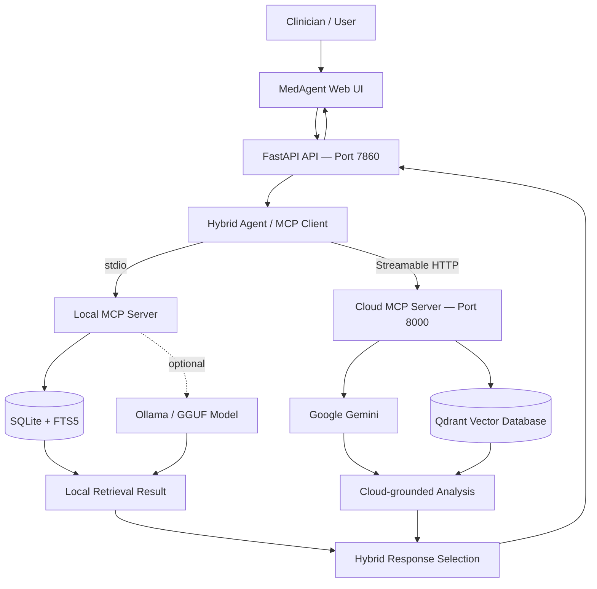

<!--
  Hybrid Medical Agent
  Documentation: https://github.com/iamakhilan/Hybrid-Medical-Agent
-->

<div align="center">

# 🩺 EdgeAgentDoc

### Hybrid Medical Agent — edge–cloud collaborative document intelligence

**Fast local recall. Deeper cloud context. Graceful fallback.**

<p>
  <a href="https://github.com/iamakhilan/Hybrid-Medical-Agent">
    
  </a>
  
  
  
</p>

<p>
  <a href="#-overview">Overview</a> ·
  <a href="#-architecture">Architecture</a> ·
  <a href="#-features">Features</a> ·
  <a href="#-quick-start">Quick Start</a> ·
  <a href="#-api-reference">API</a> ·
  <a href="#-safety--limitations">Safety</a>
</p>

</div>

---

## ✨ Overview

**Hybrid Medical Agent** is a medical-document Q&A and analysis project designed to bring together two complementary ways of working with information:

- **Local retrieval** for quick access to documents already cached on the machine.
- **Cloud retrieval and reasoning** for semantic search and deeper document-grounded analysis.

A single agent coordinates both through the **Model Context Protocol (MCP)**. The local and cloud paths run in parallel; when the cloud backend is unavailable or times out, the agent can still return a useful local result when one exists.

The included **MedAgent web UI** provides a workspace for clinical Q&A, document upload, document summaries, and focused analysis.

> **Important:** This is a software project for research, prototyping, and clinician-support workflows—not a medical device or a substitute for professional judgment. Its output can be incomplete or incorrect and must be independently verified.

## 🌟 Features

<table>
  <tr>
    <td width="50%">
      <h3>⚡ Local-first retrieval</h3>
      Cache documents in SQLite and search them with SQLite FTS5 full-text search. Local retrieval can remain available without cloud credentials.
    </td>
    <td width="50%">
      <h3>☁️ Cloud semantic search</h3>
      Use Gemini and Qdrant to process documents, create embeddings, retrieve relevant chunks, and support document-grounded responses.
    </td>
  </tr>
  <tr>
    <td width="50%">
      <h3>🔀 Parallel hybrid routing</h3>
      Send questions to local and cloud tools concurrently, track each result, and fall back to local output when the cloud path fails.
    </td>
    <td width="50%">
      <h3>📄 Document workspace</h3>
      Upload PDF and text-based documents, keep a local cache, browse stored documents, summarize content, and ask focused analysis questions.
    </td>
  </tr>
  <tr>
    <td width="50%">
      <h3>🧠 Flexible local answering</h3>
      Supports Ollama and optional GGUF inference through `llama-cpp-python`; without a local model, it can use an extractive fallback based on matching cached text.
    </td>
    <td width="50%">
      <h3>🩺 REST API + interactive docs</h3>
      FastAPI serves the browser UI and exposes endpoints for health checks, Q&A, document management, summarization, and analysis.
    </td>
  </tr>
</table>

## 🏗️ Architecture



### The three core components

| Component | Responsibility | Connection |
|---|---|---|
| `local_mcp_server/` | Local document cache, full-text search, local answering, document resources | MCP over **stdio** |
| `cloud_mcp_server/` | Document processing, embeddings, vector retrieval, Gemini-based analysis and answers | MCP over **Streamable HTTP** |
| `hybrid_agent/` | Starts the local server, connects to the cloud server, routes calls, applies timeouts and selects a response | MCP client + FastAPI |
| `ui/` | Browser workspace for Q&A, uploads, summaries and analysis | Served by FastAPI |

**Typical question flow**

1. The UI sends a question to the FastAPI API.
2. The hybrid agent asks the local and cloud MCP tools in parallel.
3. The local server searches cached text; the cloud server retrieves relevant vector-store context and uses Gemini for a grounded answer.
4. The agent selects the cloud answer when it is useful, otherwise falls back to a valid local answer when available.
5. The API returns the answer and source-level status/latency information.

The cloud MCP server is designed to run locally during development. Only its backing services—Gemini and Qdrant—need to be remote for a cloud-backed workflow.

## 🧰 Tech Stack

| Layer | Technologies |
|---|---|
| Language | Python |
| UI | HTML, CSS, JavaScript |
| API | FastAPI, Uvicorn |
| Agent integration | Model Context Protocol (MCP) Python SDK |
| Local search and storage | SQLite, FTS5 |
| Cloud LLM | Google Gemini via `google-genai` |
| Vector database | Qdrant |
| Document extraction | `pypdf` and text processing |
| Optional local inference | Ollama or `llama-cpp-python` |

## 🚀 Quick Start

### 1. Prerequisites

- Python **3.10 or newer** recommended.
- A terminal and Git.
- For cloud-backed functionality: a Gemini API key and a Qdrant instance (local or hosted).
- Optional: [Ollama](https://ollama.com/) with a model pulled locally, or a compatible GGUF model plus `llama-cpp-python`.

### 2. Clone and install

```bash
git clone https://github.com/iamakhilan/Hybrid-Medical-Agent.git
cd Hybrid-Medical-Agent

python -m venv .venv
```

Activate the virtual environment:

**Windows (PowerShell)**

```powershell
.venv\Scripts\Activate.ps1
```

**macOS / Linux**

```bash
source .venv/bin/activate
```

Install dependencies:

```bash
python -m pip install --upgrade pip
pip install -r requirements.txt
```

> **MCP version note:** The project pins `mcp==1.29.0` because the server code uses the FastMCP API from that SDK release line. Keep the pin unless you also update and test the MCP server implementation.

### 3. Configure environment variables

Create a local `.env` file from the example:

**Windows (PowerShell)**

```powershell
Copy-Item .env.example .env
```

**macOS / Linux**

```bash
cp .env.example .env
```

Open `.env` and enter your **own** credentials. Do not commit this file.

At minimum, the cloud-backed path uses:

| Variable | Purpose |
|---|---|
| `GEMINI_API_KEY` | Google Gemini API key |
| `GEMINI_MODEL` | Gemini generation model; default is `gemini-2.5-flash` |
| `GEMINI_EMBEDDING_MODEL` | Embedding model name |
| `GEMINI_EMBEDDING_DIM` | Embedding vector dimension; default is `768` |
| `QDRANT_URL` | Qdrant endpoint |
| `QDRANT_API_KEY` | Qdrant API key when required |
| `QDRANT_COLLECTION` | Vector collection name; default is `medical_documents` |
| `CLOUD_MCP_HOST` / `CLOUD_MCP_PORT` | Cloud MCP server bind address; defaults to `127.0.0.1:8000` |
| `CLOUD_SERVER_URL` | MCP URL used by the hybrid agent; default is `http://127.0.0.1:8000/mcp` |
| `CLOUD_TIMEOUT_SECONDS` | Cloud response timeout before fallback; default is `20` |
| `OLLAMA_HOST` / `OLLAMA_MODEL` | Optional local Ollama endpoint and model |
| `LOCAL_LLM_MODEL_PATH` | Optional GGUF model path |
| `LOCAL_DB_PATH` | Optional SQLite database path |

The local server has safe defaults. Cloud tools report configuration errors if Gemini or Qdrant settings are missing, and the hybrid agent can continue with local-only answers.

> **Credential hygiene:** Never publish API keys in source control, screenshots, logs, or issue reports. The repository's earlier environment template contained live-looking credentials. Removing them from the current file does not erase Git history. Treat any previously committed key as exposed: revoke/rotate it immediately and consider cleaning repository history before making the repository public. Keep `.env` private; use `.env.example` only for non-secret configuration defaults.

### 4. Start the application

Start each process in a separate terminal from the repository root, with the virtual environment activated.

**Terminal A — cloud MCP server**

```bash
python -m cloud_mcp_server.server
```

By default, it listens on `http://127.0.0.1:8000/mcp`.

**Terminal B — web app and API**

```bash
python -m hybrid_agent.api
```

Open:

- **MedAgent UI:** [http://127.0.0.1:7860](http://127.0.0.1:7860)
- **Interactive API documentation:** [http://127.0.0.1:7860/docs](http://127.0.0.1:7860/docs)
- **Health endpoint:** [http://127.0.0.1:7860/api/health](http://127.0.0.1:7860/api/health)

The API starts the local MCP server as a subprocess. You do not need to start the local server separately when running the API. The REST layer accesses local document metadata and content through the hybrid agent's MCP client; it does not query SQLite directly.

### 5. Alternative: run the interactive agent

For a terminal-only smoke test, start the cloud MCP server in one terminal, then run:

```bash
python -m hybrid_agent.agent
```

The agent checks server health and opens a question prompt. Type `quit` or `exit` to stop the session.

### 6. Local-only development

The local MCP server can also be launched on its own:

```bash
python -m local_mcp_server.server
```

It uses stdio, so it expects to be controlled by an MCP client rather than queried directly with a browser or `curl`.

## 📊 Evaluation reported by the project

The accompanying EdgeAgentDoc report evaluates the offline/local path and routing logic using a **synthetic patient record** and a set of 20 authored questions. These figures are from that report, not a claim of clinical validation or live cloud performance.

| Experiment | Reported result | Interpretation |
|---|---:|---|
| Local retrieval returned a match | 20 / 20 questions | The local OR-query construction retrieved the record for each test question |
| Local extractive answers contained the expected answer key | 15 / 20 (75%) | Retrieval found the record, but short snippets sometimes missed the needed value |
| Local answer-path latency | 0.30 ms median; 0.54 ms p95 | In-process measurement; excludes real MCP transport overhead |
| Strict-AND query ablation | 0 / 20 matches | Requiring every raw question term was too restrictive |
| Cache scaling | 0.33 ms median at 1 document to 4.60 ms at 1,000 documents | Local search remained low-latency in the reported test |
| Injected cloud-failure scenarios | 10 / 10 answered in each of five conditions | Routing/fallback was tested with stubbed transport, not a live cloud RAG evaluation |

**Important caveats from the report:** the cloud Gemini + Qdrant RAG path has not been evaluated end-to-end against a labelled question set. The simulated 1.2-second cloud response is not a live measurement, and the routing tests used in-process stub sessions rather than real MCP transport. Treat these as prototype engineering measurements only.

### Run the regression tests

From the repository root with dependencies installed:

```bash
python -m unittest discover -s tests -v
```

The tests cover cloud-answer preference, local-preview inclusion, fallback when cloud retrieval has no relevant document context, and combined failure reporting.

## 🖥️ Using the Web UI

### Evidence-linked answers

Original uploaded files are retained on the API host under a local `source_files/` directory so evidence links can open the source. This directory is ignored by Git; do not expose the unauthenticated API to untrusted networks or commit patient records.


When the cloud retrieval path returns source chunks, Q&A responses include expandable evidence cards with the source document title, PDF page number when available, and retrieved passage. Page numbers are retained as metadata during PDF extraction and cloud chunk ingestion. Text files are treated as a single page. Evidence cards show retrieved passages; they do not guarantee that every sentence in a generated answer is fully supported. If the cloud retrieval path is unavailable, the UI explicitly indicates that source passages were not returned.

### Medical timeline and safety review

The Documents workspace includes two opt-in tools:
- **Build medical timeline** extracts recognizable dated lines containing clinical terms and labels them as lab results, medications, allergies, diagnoses, or clinical notes when the wording supports that label. Each event retains its source document and page where available.
- **Check for discrepancies** uses transparent pattern-based heuristics to flag possible medication-dose conflicts, allergy-record conflicts, differing lab units, numeric lab values without a detected unit, clinical details without a recognizable date, and medication-related entries older than one year.

These checks are review aids, not a medical reasoning system. They can miss issues or flag false positives; they never choose which record is correct and do not make diagnoses or treatment recommendations. Review each passage against the original record. Existing cached documents are supported; old cache entries without page metadata show page unavailable.


### Clinical Q&A
Ask questions about documents in the knowledge base—for example, requests for relevant lab values, medication history, diagnosis timelines, or abnormal findings. The UI displays the selected answer and reports local/cloud status.

### Documents
Upload a supported PDF or text document. The application extracts the text, caches it in SQLite, and attempts cloud ingestion for semantic retrieval. Cloud ingestion is best-effort, so a local cache can still be useful if the cloud service is not configured.

### Deep analysis and summaries
Choose a cached document or paste text, then enter a focused question. Use the summary focus field to steer the generated summary toward a subject such as diagnoses, medications, or lab values.

Use synthetic or properly de-identified examples during development; do not upload real patient information to third-party services unless you have the necessary authorization, security controls, and legal basis.

## 🔌 API Reference

The FastAPI application exposes the following endpoints:

| Method | Endpoint | Purpose |
|---|---|---|
| `GET` | `/api/health` | Check local and cloud MCP server status |
| `POST` | `/api/ask` | Ask a question using hybrid retrieval |
| `POST` | `/api/documents` | Upload and ingest a PDF/text document |
| `GET` | `/api/documents` | List documents in the local SQLite cache |
| `GET` | `/api/timeline` | Extract dated, source-linked clinical events from cached records |
| `GET` | `/api/safety-check` | Flag possible cross-record inconsistencies for human review |
| `POST` | `/api/summarize` | Summarize document text or a cached document |
| `POST` | `/api/analyze` | Analyze document text against a question |
| `GET` | `/docs` | Interactive OpenAPI / Swagger UI |

Example: ask a question from the command line:

```bash
curl -X POST http://127.0.0.1:7860/api/ask \
  -H "Content-Type: application/json" \
  -d '{"question":"What relevant findings are mentioned in the available documents?","top_k":5}'
```

Example: health check:

```bash
curl http://127.0.0.1:7860/api/health
```

For exact request and response schemas, use the interactive API docs at `/docs`.

## 🧩 MCP Tool Catalog

### Local MCP server

| Tool / resource | Description |
|---|---|
| `local_health_check` | Report local server and cache health |
| `cache_document` | Add or update a document in the local cache |
| `search_local_cache` | Search cached content |
| `ask_local` | Answer using locally retrieved document chunks |
| `list_cached_documents` | List cached document metadata through MCP |
| `get_cached_document` | Fetch cached document text through MCP |
| `cache://docs/{doc_id}` | Resource containing a cached document's text |

### Cloud MCP server

| Tool | Description |
|---|---|
| `cloud_health_check` | Check server reachability and service configuration |
| `ingest_document` | Process text, create chunks/embeddings, and store them in Qdrant |
| `search_cloud_documents` | Return semantic search hits |
| `fetch_deep_cloud_context` | Build a context block from retrieved chunks |
| `analyze_document` | Analyze a document against a focused question |
| `summarize_document` | Generate a focused document summary |
| `answer_with_cloud_context` | Retrieve relevant context and generate a grounded answer |

## 📁 Project Structure

```text
Hybrid-Medical-Agent/
├── cloud_mcp_server/
│   ├── server.py              # Cloud MCP tools and HTTP server
│   ├── config.py               # Gemini, Qdrant and server settings
│   ├── document_processor.py   # Document cleanup and chunking
│   ├── embedding_service.py    # Embedding generation
│   ├── gemini_service.py       # Gemini integration
│   ├── qdrant_service.py       # Vector database integration
│   └── requirements.txt
├── hybrid_agent/
│   ├── agent.py                # Parallel routing and response selection
│   ├── api.py                  # FastAPI endpoints and UI hosting
│   ├── api_models.py            # API schemas
│   ├── config.py               # Agent configuration
│   ├── pdf_utils.py             # PDF/text extraction helpers
│   └── requirements.txt
├── local_mcp_server/
│   ├── server.py               # Local MCP tools
│   ├── db.py                   # SQLite cache and full-text search
│   ├── local_llm.py             # Optional local inference/fallback
│   ├── config.py               # Local configuration
│   └── requirements.txt
├── tests/
│   └── test_agent_merge.py    # Routing and fallback regression tests
├── ui/
│   ├── index.html               # Web interface
│   ├── app.js                   # Browser interactions
│   └── style.css                # UI styling
├── .env.example                 # Environment variable template
├── requirements.txt             # Combined dependencies
├── sample_patient_record.txt    # Synthetic/sample development data
└── README.md
```

## 🛠️ Troubleshooting

<details>
<summary><strong>The UI opens, but cloud status is unhealthy</strong></summary>

Confirm that the cloud MCP server is running in its own terminal and that `CLOUD_SERVER_URL` matches its address. Then verify `GEMINI_API_KEY`, `QDRANT_URL`, and (when required) `QDRANT_API_KEY` in your local `.env`. Use `/api/health` and the cloud health tool to see the reported status.
</details>

<details>
<summary><strong>Cloud calls time out</strong></summary>

Check network access and the Gemini/Qdrant configuration. The agent uses a configurable timeout; set `CLOUD_TIMEOUT_SECONDS` to adjust the wait. Local retrieval can still work if the document was cached successfully.
</details>

<details>
<summary><strong>The local answer has little or no useful context</strong></summary>

Upload/cache the document first, then ask a question using terms present in that document. The local path searches cached text; it cannot infer details that are not in the cache. A compatible local model is optional and does not replace document retrieval.
</details>

<details>
<summary><strong>MCP dependency version errors</strong></summary>

Re-create or update the environment using the repository's pinned dependencies: `pip install -r requirements.txt`. Avoid upgrading `mcp` independently without adapting and testing the server code.
</details>

<details>
<summary><strong>PDF extraction fails</strong></summary>

Confirm the file is a readable PDF or try a text-based copy. Image-only scans may need OCR support, which is not currently included in the documented default workflow.
</details>

## 🔐 Safety & Limitations

- **Not a diagnostic system:** outputs are generated and may be inaccurate, incomplete, outdated, or misinterpreted.
- **Human review is required:** confirm any clinical detail against the original record and trusted clinical references.
- **Privacy matters:** medical records can contain highly sensitive personal information. Use synthetic/de-identified data for testing and verify applicable privacy, consent, retention, and security requirements before processing real data.
- **Cloud processing sends data to external services:** document ingestion and cloud-grounded answers may transmit document text or derived representations to configured Gemini/Qdrant services. Do not assume data stays on-device.
- **No guaranteed availability:** local fallback depends on the document being cached and relevant text being retrievable. Cloud features depend on external service configuration and availability.
- **Prototype API security:** CORS is restricted to the local UI origins by default, but the API does not yet implement user authentication or authorization. Do not expose it to an untrusted network.
- **No formal clinical validation is implied:** this repository does not claim regulatory clearance, clinical validation, or suitability for autonomous care.

## 🗺️ Roadmap Ideas

- [x] Initial regression tests for hybrid response selection and fallback
- [ ] Configurable access control and authentication for the API
- [ ] More robust citation/provenance display for generated answers
- [ ] Observability and structured logging with sensitive-data redaction
- [ ] Containerized deployment for the cloud MCP server
- [ ] A documented evaluation set for retrieval quality and answer faithfulness

## 🤝 Contributing

Issues and pull requests are welcome. For meaningful changes:

1. Open an issue to describe the bug or proposal.
2. Keep credentials and patient data out of commits and logs.
3. Test both healthy and degraded modes where practical.
4. Update this README when setup, endpoints, or tool contracts change.

## 📄 License

No license file was present in the repository when this README was prepared. Unless a license is added, reuse and redistribution are not automatically granted; add a license file that matches your intended terms.

---

<div align="center">

**Built to explore a practical question: what can a medical-document agent do when local speed and cloud context work together?**

<sub>Made with Python · FastAPI · MCP · SQLite · Gemini · Qdrant</sub>

</div>
